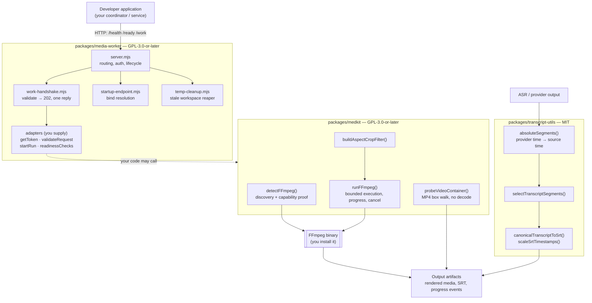

# Architecture

Three packages with **no shared runtime code**. Each can be installed and used
alone; none imports another. The diagram below shows the intended composition,
not a required one.

The dotted edge is deliberate: the worker does **not** depend on `medkit`. A
worker can run any workload, and `medkit` is equally usable from a CLI script
with no HTTP server at all. `transcript-utils` is separate from both.

## Package boundaries

| Package | Runtime dependencies | Build step | Owns |
|---|---|---|---|
| `media-worker` | none (Node built-ins) | none (plain `.mjs`) | HTTP contract, auth, lifecycle, temp reaping |
| `medkit` | none at runtime; expects an FFmpeg binary | TypeScript → `dist/` | Process execution, container metadata, filter building |
| `transcript-utils` | none (Node built-ins) | TypeScript → `dist/` | Time arithmetic and subtitle serialisation |

No package imports from another. Duplicating a few lines is preferred over a
cross-package dependency, so each stays independently installable.

## Data flow

1. **Ingress.** The coordinator sends `POST /work` with a unit id and lease token.
2. **Validation.** `validateRequest` checks the lease against *your* store
   **before** anything is acknowledged.
3. **Acceptance.** The worker replies `202` exactly once and starts the run.
4. **Work.** `startRun` performs the job. It may call `medkit` to encode, and
   `transcript-utils` to build subtitles — both are ordinary function calls.
5. **Output.** Artifacts land wherever your runner writes them; the worker itself
   only reports the outcome.

## Authentication boundary

`POST /work` requires `Authorization: Bearer <token>`; comparison is
constant-time and an **unset token is never valid** (every call is `401`).
`/health` and `/ready` are deliberately unauthenticated so a platform probe can
reach them. The worker binds **loopback by default** and speaks **plain HTTP** —
it expects TLS to terminate in front of it.

Leases are the second boundary: possessing a valid token is not enough; the
lease must match what your store says is current, and a competing lease is
refused with `409`.

## Temporary file lifecycle

- Workspaces are created under the OS temp directory (`TMPDIR`).
- `temp-cleanup.mjs` removes only directories matching an explicit prefix list
  (default `media-worker-*`), older than **24 hours** by default.
- The sweep runs at startup and then hourly, so a crashed run's leftovers are
  reclaimed without a restart.
- `medkit` stages font/fontconfig assets **once per process** and removes them on
  process exit, best effort.

## Error handling

| Situation | Behaviour |
|---|---|
| Body over 256 KiB | `400`, never truncated |
| Unreadable or invalid body | `400` |
| Missing/incorrect token | `401`, run never starts |
| Competing lease for an in-flight unit | `409` |
| Same lease redelivered | idempotent `202` |
| Run fails **after** acceptance | logged; still exactly one reply — the lease is the authority |
| Shutdown during work | new deliveries refused, in-flight runs aborted, close always settles |
| FFmpeg missing or incapable | detection reports `available: false` with the reason; never a silent substitution |
| FFmpeg exits non-zero / times out | non-zero code or a timeout error; cancellation settles once |
| Unreadable media metadata | `null`, never `0` |
| Malformed transcript timings | throws instead of emitting drifting subtitles |

## Dependencies

- **Node.js 20.11+** for all three.
- **FFmpeg** for `medkit` only, discovered via `FFMPEG_PATH` → bundled
  `ffmpeg-static` → `PATH` → known install locations. The first real build found
  decides; if it lacks a required filter or encoder it is refused by name.
- No database, queue, HTTP framework or ORM is required by any package.

## Licensing boundaries

- `media-worker` and `medkit` — **GPL-3.0-or-later**, because they drive FFmpeg
  builds that are commonly GPLv3.
- `transcript-utils` — **MIT**, with no FFmpeg dependency and no runtime
  dependencies.
- No FFmpeg binary is distributed. The font used for text rendering ships with
  its own notice.

See [LICENSING.md](LICENSING.md).

## Detail per package

- `media-worker`: adapter contracts and limits — [WORKER.md](WORKER.md)
- `medkit`: `detectFFmpeg()` order, `runFFmpeg()` bounds, probe semantics
- `transcript-utils`: `absoluteSegment()` applies a chunk offset exactly once;
  `selectTranscriptSegments()` clamps to a window and rejects malformed timings;
  `scaleSrtTimestamps()` re-times an existing SRT.
